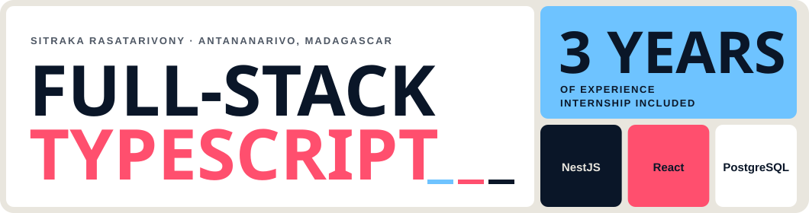
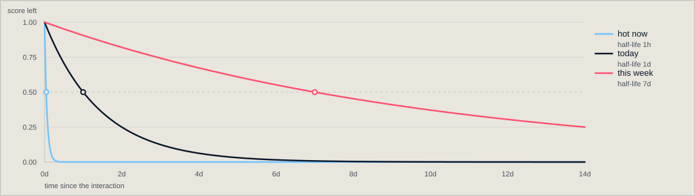
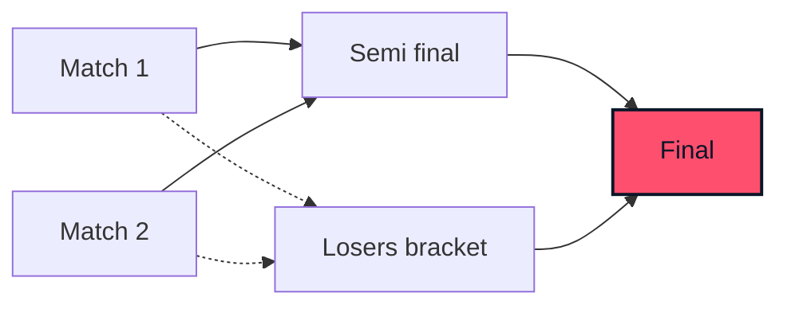

  <picture>
    <source media="(prefers-color-scheme: dark)" srcset="assets/banner.svg">
    
  </picture>

Full-stack developer in Antananarivo, Madagascar, with three years of experience, <!-- @fact ID-05 -->
internship included. I mostly work with NestJS and Node.js on the server, React and
Next.js on the client, and PostgreSQL underneath.

The three projects below each started with a problem I did not know how to solve.
I read, compared what others had done, and picked the idea that fit. None of it is
my invention. What I can explain is the problem, the idea, and why it fit.

---

### cine-taste · a "trending" ranking that keeps itself up to date

Every view or like a movie gets counts a little less as time passes, the same way
yesterday's news slips down a front page. While reading about how sites build their
trending lists, I came across exponential decay: each interaction loses half its
weight after a fixed delay, called the half-life.

The useful part is what it removes. The ranking stays correct on its own, so there is
no nightly job recomputing it. Three half-lives run side by side, which gives three
lists from the same data: right now, today, this week.

  <picture>
    <source media="(prefers-color-scheme: dark)" srcset="assets/decay.svg">
    
  </picture>

Next.js 16 · Postgres · Drizzle &nbsp;·&nbsp;
[repo](https://github.com/SitrakaRasata/cine-taste) &nbsp;·&nbsp;
[live](https://cine-taste-sr.vercel.app)

### immo-grant · access rules kept in the database

A real estate app where the database itself decides who can see or edit a listing,
using PostgreSQL row-level security. The application code does not repeat those rules.

The case I cared about was delegation. An agent can manage a listing they do not own,
under a mandate, and that right ends by itself when the mandate expires. Each cell of
this table is a test:

|                      | see | create | edit | delete |
|---|:--:|:--:|:--:|:--:|
| visitor, published listing | yes | — | — | — |
| visitor, draft       | —   | — | — | — |
| client               | yes | — | — | — |
| owning agent         | yes | yes | yes | yes |
| mandated agent       | yes | — | yes | — |
| other agent          | —   | — | — | — |

The tests run against a real PostgreSQL started in memory (PGlite), so there is
nothing to install. Row-level security has a few well-known traps. I ran into them
one by one, and the tests now check them.

SvelteKit · Supabase · PGlite &nbsp;·&nbsp;
[repo](https://github.com/SitrakaRasata/immo-grant) &nbsp;·&nbsp;
[live](https://immo-grant.vercel.app)

### tournament-engine · one description per tournament format

Each format is written once, as a small map of matches: where the winner goes next,
and where the loser goes.

Solid arrows carry the winner, dashed ones the loser. The rest of the app only reads
that map. Recording a result, fixing a wrong score, knowing when the tournament is
over: none of it needs to know which format is being played. Adding a format means
adding one file.

The app also shows each player's chances of winning, based on Elo ratings, the
system chess uses.

NestJS · React · SQLite &nbsp;·&nbsp; 249 tests &nbsp;·&nbsp; <!-- @fact PRJ-TOUR-01 -->
[repo](https://github.com/SitrakaRasata/tournament-engine) &nbsp;·&nbsp;
no public demo, it runs with one Docker command

---

### Where I have worked

**Co-founder and full-stack developer · [NEXTRI](https://nextrimg.github.io)** <!-- @fact NX-02 -->
*Antananarivo · May 2026 – present*

NEXTRI is a collective of three software engineers. Together we designed and built a
modular management application: users, groups and permissions, invoicing with PDF
output, dashboards. The API is in NestJS and TypeScript on Fastify, with PostgreSQL
through Prisma and a Redis cache. The interface is in Next.js and React. It is not
deployed yet and has no users.

**Application developer · Stellar-IX (Axian Group)** <!-- @fact EXP-STX-01 -->
*Antananarivo · September 2022 – January 2025*

I rewrote the backend of a VMware monitoring application in FastAPI, with caching,
and its average data load dropped from 4s to 300–500ms. Routine operations went
through the vSphere REST API, and pyVmomi covered what only the SOAP SDK could do.

I shipped more than ten full-stack modules to production, with Docker CI/CD and code
review on every change. The codebase ran on legacy ejs and Node, and I argued for
TypeScript on every new module. It took several team discussions before it was
accepted. I also took part in the team's technical decisions on architecture, data
patterns and code quality, in a team of ten working Agile.

**Developer, internship · Ingenosya Madagascar**
*Antananarivo · August 2021 – February 2022*

In a team of eight, I built the administration space and the web services of an
audio-visual e-learning platform for a client in Paris. We started from scratch and
took it to pre-production. I attended the client meetings.

### Education and training

**Master MIAGE**, Mobiquity, Databases and Systems Integration (MBDS).
Université Côte d'Azur & IT University, Antananarivo · 2022 – 2024.
**Bachelor in computer science**, Web and Design. IT University, Antananarivo · 2018 – 2022.

**DevSecOps Professional**, Practical DevSecOps, January 2024. A three-day course
with an instructor and no exam, so a course rather than a certification.

### The stack

**Main** · TypeScript · Node.js · NestJS · React · Next.js · PostgreSQL
**Backend and API** · Express · REST API design · WebSocket · OpenAPI
**Frontend** · Angular · Tailwind CSS
**Databases and ORMs** · MongoDB · MySQL · ClickHouse · Redis · Prisma · Mongoose
**DevOps** · Docker · CI/CD (GitHub Actions)
**Quality** · code review · unit and integration tests
**Other languages** · Python (FastAPI) · Java (Spring Boot, Jakarta EE)
**Methods and AI** · Agile (Scrum) · AI-assisted development (Claude Code; aider with local models through Ollama)

---

  <picture>
    <source media="(prefers-color-scheme: dark)" srcset="https://raw.githubusercontent.com/SitrakaRasata/SitrakaRasata/metrics/latency.svg">
    
  </picture>

Both live demos are checked every six hours from GitHub's servers. The chart shows
the median of five requests, and a failed check leaves a gap in the line instead of a
fake fast response. [The workflow](.github/workflows/metrics.yml) does the measuring.

---

[LinkedIn](https://linkedin.com/in/sitraka-rasata) &nbsp;·&nbsp; sitraka.rasatarivony@gmail.com <!-- @fact ID-10 ID-06 -->

*Malagasy (native) · French (fluent) · English (intermediate to professional, written)*
